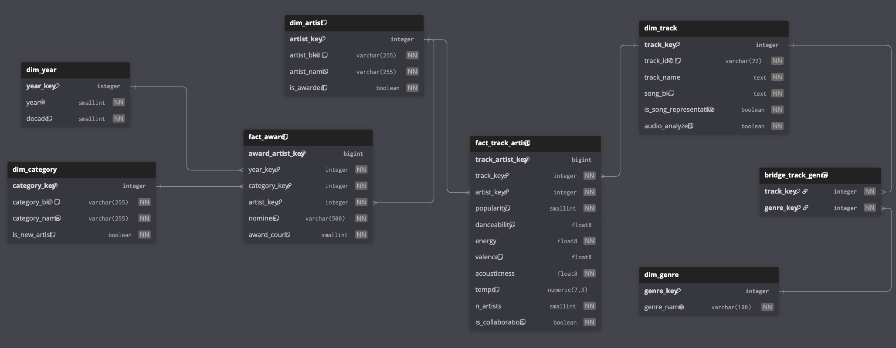
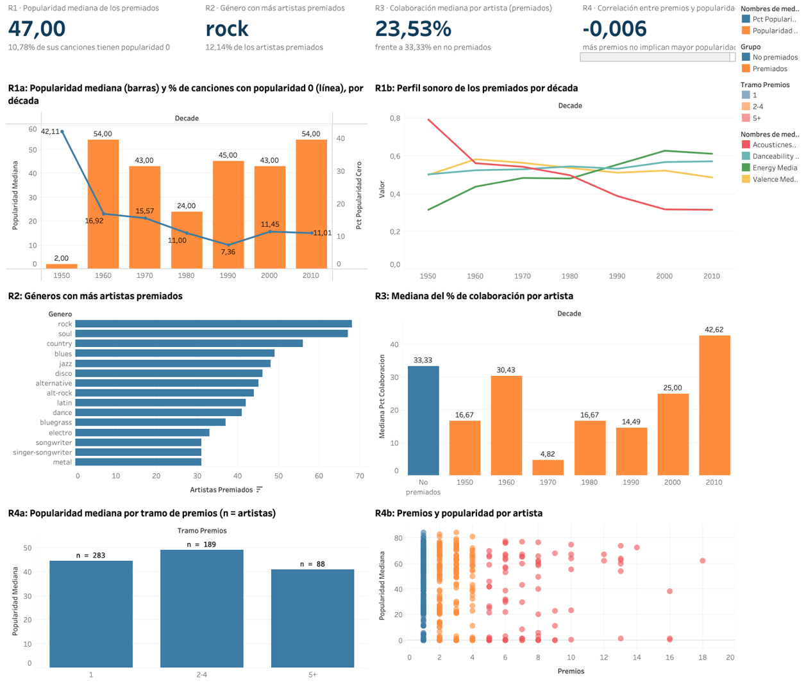

# Spotify & Grammy Reliable Batch Pipeline

Pipeline batch que integra los ganadores de los premios Grammy con una muestra de pistas de Spotify en un Data Warehouse dimensional en PostgreSQL. Está orquestado con Apache Airflow 3.1.8, validado con Great Expectations 1.23.2 y consumido por un dashboard de Tableau.

| Documento | Contenido |
| --- | --- |
| `docs/architecture.md` | Arquitectura conceptual y estructura del DAG (diagramas) |
| `notebooks/data_profiling.ipynb` | Profiling, requisitos y registro de decisiones D1 a D18 |
| `docs/quality_rules.md` | Riesgos y reglas de calidad con severidad |
| `docs/gx_design.md` y `docs/gx_expectation_map.md` | Diseño de GX y mapa de expectativas por regla |
| `docs/transformation_design.md` | Transformación e integración |
| `docs/dimensional_model.md` | Modelo dimensional y vistas de KPI |
| `docs/dag_design.md` | DAG, fallas, reintentos, observabilidad y rerun seguro |
| `docs/traceability_matrix.md` | Matriz de trazabilidad de extremo a extremo |
| `docs/dashboard/README.md` | Dashboard, conexión al DW y comprobación de valores |
| `docs/evidence/README.md` | Registro de evidencias EV-01 a EV-37 |

## 1. Problema y objetivo analítico (Problem and analytical objective)

Un premio Grammy reconoce a un artista en un momento dado, pero no dice si su música sigue vigente. El objetivo es integrar los ganadores Grammy (1958 a 2018) con la muestra de Spotify a nivel de artista para analizar la vigencia actual, el sonido, el género y la colaboración de los artistas premiados.

El proyecto no pretende medir el mercado musical, la popularidad en el momento del premio ni el desempeño de nominados no ganadores.

## 2. Requisitos analíticos (Analytical requirements)

Los requisitos se definieron después del profiling, a partir de la evidencia, para que cada uno fuera respondible con los datos disponibles: Grammy solo contiene ganadores, Spotify no tiene dimensión temporal, la integración solo es posible por artista y la muestra de Spotify está balanceada por género.

| ID | Pregunta analítica | Datos requeridos (fuente) | KPI esperado | Nivel de detalle | Por qué requiere ambas fuentes |
|---|---|---|---|---|---|
| R1 | ¿Qué tan vigentes y cómo suenan hoy los artistas premiados de cada década de premiación? | Grammy: `year`, `artist` (`category`/`nominee` para Best New Artist). Spotify: `artists`, `track_id`, `track_name`, `popularity`, `danceability`, `energy`, `valence`, `acousticness`, `tempo` | Popularidad mediana por década (consolidada por canción), % de canciones con popularidad 0, perfil sonoro medio por década, n de artistas por década | Artista × década del premio | La época solo existe en Grammy; la popularidad y el sonido solo en Spotify |
| R2 | ¿En qué géneros de Spotify se ubican los artistas premiados? | Grammy: `artist`. Spotify: `artists`, `track_genre`, `popularity` | N.º y % de artistas premiados por género; popularidad mediana por género | Artista × género | Grammy define quién cuenta; el género viene de Spotify |
| R3 | ¿Qué tan colaborativos son los artistas premiados y cambia según la época? | Grammy: `artist`, `year`. Spotify: `artists`, `track_id` | Mediana del % de colaboración por artista (mínimo 5 canciones), por década; referencia: artistas no emparejados con el mismo mínimo | Artista × década del premio | Grammy da el grupo y la época; Spotify, la colaboración |
| R4 | ¿Los artistas con más premios atribuidos son más populares hoy? | Grammy: `artist` (conteo). Spotify: `popularity` | Popularidad mediana por tramo de premios (1, 2–4, 5+); correlación premios–popularidad | Artista | El conteo viene de Grammy; la popularidad de Spotify |

## 3. Fuentes de datos (Data sources)

| Fuente | Forma en el pipeline | Volumen | Aporta |
| --- | --- | --- | --- |
| Spotify | Archivo CSV `data/raw/spotify_dataset.csv`, una fila por pista × género | 114,000 filas | Artistas, género, popularidad y medidas de audio |
| Grammy | Tabla `grammy_awards` en la base PostgreSQL `grammy_source`, cargada desde `data/raw/the_grammy_awards.csv` con `sql/source_setup.sql` | 4,810 filas, años 1958 a 2019 | Año, categoría, nominado, artista y ganador |

- La fuente Grammy simula una base operacional: el pipeline la lee por conexión con `etl_user`, que solo tiene lectura. La carga se reconcilió contra el CSV con 29 verificaciones (EV-03, EV-04).
- Se extraen solo las columnas que usan los requisitos (D12).
- El contrato de la fuente Spotify (escalas de audio, popularidad de 0 a 100) se toma de la documentación de Spotify Web API, citada en el notebook.

## 4. Arquitectura del pipeline (Pipeline architecture)

Fuentes → extracción → validación raw con GX → transformación e integración → validación de la capa preparada con GX → carga del DW → vistas de KPI → Tableau. Cada run trabaja en su propia carpeta `data/work/<run_id>/` (`raw/`, `validation/`, `prepared/`), y una falla `critical` en cualquiera de las dos compuertas detiene el run antes de tocar el DW.

Diagramas y decisiones de arquitectura: `docs/architecture.md`.

## 5. Hallazgos del profiling (Data profiling findings)

- **Grammy solo registra ganadores, salvo 2019.** En 2019, 84 de 84 grupos (año, categoría) tienen más de una fila: nominados mezclados con ganadores sin forma reproducible de separarlos. Se excluye 2019 (D1).
- **El artista falta por estructura, no por error.** Solo el 61.75 % de las filas Grammy tiene `artist`. En las categorías "New Artist" el premiado es el propio nominado (D2).
- **Spotify tiene duplicados y conflictos de popularidad.** Hay 450 filas idénticas (D6) y 720 `track_id` con popularidades distintas, 673 de ellos por 1 punto (D7).
- **La popularidad 0 es frecuente y engañosa.** 16,020 filas tienen popularidad 0, y el 30.7 % de las canciones con 0 tiene otra versión con popularidad mayor. Por eso la popularidad se consolida por canción y se reporta el % de ceros (D8).
- **Hay pistas sin análisis de audio.** 157 filas tienen `tempo`, `danceability` y `valence` en 0 a la vez, 138 del género *sleep*. Pasan a nulo en la capa preparada (D9).
- **La integración solo es posible por artista**, y prioriza precisión sobre cobertura: una atribución falsa es peor que una omisión (D4, D13). El profiling midió entre 44 % y 49 % de emparejamiento.

Detalle y celdas de evidencia: `notebooks/data_profiling.ipynb`.

## 6. Riesgos y reglas de calidad (Quality risks and quality rules)

29 reglas: 10 sobre el raw de Spotify (DQ-S), 8 sobre el raw de Grammy (DQ-G) y 11 sobre la capa preparada (DQ-P). Cada una tiene atributo, dimensión, umbral justificado, severidad, riesgo asociado y requisito que protege.

| Severidad | Significado | Acción del pipeline |
| --- | --- | --- |
| Critical | Rompe la identidad, el contrato o la estructura | La validación falla y el run se detiene |
| Warning | Reduce la cobertura o la representatividad | Se registra y el pipeline continúa |
| Informational | Señal de monitoreo | Se registra; nunca bloquea |

Tabla completa: `docs/quality_rules.md`.

## 7. Diseño de validación con Great Expectations (Great Expectations validation design)

- Contexto de GX persistente en archivo (`gx/`), versionado con el repositorio.
- 11 suites: `spotify_raw_suite` y `grammy_raw_suite` (con checkpoints) para el raw, y 9 para la capa preparada: una por tabla del modelo más `prepared_checks_suite`, que verifica huérfanos, consistencia entre tablas y la tasa de emparejamiento.
- Cada expectativa lleva su `rule_id` y severidad en `meta`. `src/gx_setup.py` crea las suites de forma repetible y genera `docs/gx_expectation_map.md`.
- La decisión de cada compuerta sale de la falla de mayor severidad: `critical` detiene el run (los resultados se guardan antes), `warning` e `info` dejan continuar con registro.
- Con el lote actual, DQ-G06 falla como `warning` a propósito: detecta el lote 2019 contaminado y D1 lo resuelve.

Diseño: `docs/gx_design.md`.

## 8. Estrategia de transformación e integración (Transformation and integration strategy)

- **Normalización común:** minúsculas, sin tildes, espacios colapsados y recortados (D4, D10).
- **Rama Spotify:** elimina duplicados exactos (D6), consolida la popularidad por pista y por canción (D7, D8), marca las pistas sin análisis de audio (D9), separa la lista de artistas (D5) y descarta las filas sin artista (D14).
- **Rama Grammy:** excluye 2019 (D1), usa el nominado en "New Artist" (D2) y excluye filas sin artista atribuible (D3).
- **Integración:** emparejamiento por nombre completo y, si no coincide, por partes, aceptando solo si todas las partes coinciden, con lista de exclusión de colectivos (D4, D13). Primera corrida: 49.48 % de las filas atribuibles emparejadas (1,342 de 2,712).
- Cada run escribe `transform_report.json` con conteos, exclusiones por motivo y tasa de emparejamiento.

Detalle: `docs/transformation_design.md`.

## 9. Modelo dimensional (Dimensional model)

Constelación con dos procesos de negocio:

- `fact_award`: grano premio × artista emparejado.
- `fact_track_artist`: grano pista × artista, con popularidad, audio, `n_artists` e `is_collaboration`.
- Dimensiones `dim_artist`, `dim_year` (con década), `dim_category`, `dim_track` (con canción y versión representativa) y `dim_genre`, más el puente `bridge_track_genre`.

Sobre el modelo, `sql/kpi_views.sql` define las vistas de KPI que consume el dashboard.

DDL: `sql/dw_schema.sql`. Detalle: `docs/dimensional_model.md`.

## 10. Diseño del DAG de Airflow (Airflow DAG design)

DAG `reliable_music_pipeline` (TaskFlow, `airflow.sdk`), de ejecución manual, con los parámetros `spotify_source` y `grammy_table`:

`extract_spotify` → `validate_spotify_raw` y `extract_grammys` → `validate_grammys_raw` → `transform_and_integrate` → `validate_prepared` → `load_dw`

El DAG solo orquesta; la lógica vive en `src/` (`extract.py`, `validation.py`, `transform.py`, `load.py`). Diagrama: `docs/architecture.md`. Detalle: `docs/dag_design.md`.

## 11. Política de fallas y reintentos (Failure and retry policy)

| Tipo de falla | Comportamiento |
| --- | --- |
| Error determinista: contrato de la fuente, contrato de transformación, calidad `critical`, integridad de carga | `AirflowFailException`, sin reintento: repetir no cambia el resultado |
| Base de datos no disponible (`extract_grammys`, `load_dw`) | 3 reintentos cada 30 s |
| Falla de infraestructura del executor en el resto de tareas | 1 reintento a los 10 s (`default_args`) |
| Calidad `warning` o `info` | El run continúa y queda registrado |

Detalle: `docs/dag_design.md`, sección 3.

## 12. Evidencia de ejecución exitosa (Successful execution evidence)

Test A, run `manual__2026-10-16T17:49:00.513553+00:00`: las 7 tareas terminan en success en el primer intento, en 3 min 39 s, con la compuerta de Grammy en `warning` (DQ-G06). Incluye logs, reportes de transformación y carga y resultados de validación.

Evidencias: `docs/evidence/E7_A_success/` (desde EV-06).

## 13. Evidencia de falla controlada (Controlled failure evidence)

| Prueba | Qué se provoca | Resultado |
| --- | --- | --- |
| B | Fuente con `popularity` = 150 en una fila (`src/make_bad_source.py`), que viola DQ-S04 | `validate_spotify_raw` falla en un solo intento, las tareas siguientes no corren y el DW no cambia (35 s) |
| C1 | Base de datos detenida durante toda la ventana de reintentos | `extract_grammys` agota sus 4 intentos y el run falla sin tocar el DW (1 min 41 s) |
| C2 | Base de datos detenida y levantada durante los reintentos | `extract_grammys` se recupera en el intento 3 y el run termina en success (2 min 23 s) |

Evidencias: `docs/evidence/E7_B_failure/`, `docs/evidence/E7_C1_reintentos_agotados/` y `docs/evidence/E7_C2_recuperacion/` (hasta EV-31).

## 14. Estrategia de repetibilidad (Repeatability strategy)

- `load_dw` vacía y recarga el DW en una sola transacción: un rerun con las mismas entradas deja el mismo contenido y una falla no deja el DW a medias.
- Cada run usa su propia carpeta de trabajo, así que un run no pisa los archivos de otro.
- El rerun de prueba (`manual__2026-10-17T05:54:39.225421+00:00`) produjo los mismos reportes que el Test A salvo `run_id` y marcas de tiempo, sin duplicados en ninguna dimensión.

Evidencias: `docs/evidence/E7_rerun/`. Detalle: `docs/dag_design.md`, sección 5.

## 15. Dashboard y salidas analíticas (Dashboard and analytical outputs)

Tableau Desktop con conexión en vivo a `music_dw` como `dashboard_user`, un rol que solo puede leer las seis vistas `v_kpi_*`. 4 KPIs y 6 visualizaciones responden R1 a R4:

- **R1:** popularidad mediana de los premiados de 47.0, con 10.78 % de canciones en 0. El sonido se vuelve más enérgico y menos acústico en las décadas recientes.
- **R2:** rock es el género con más artistas premiados (12.14 %).
- **R3:** los premiados colaboran menos que los no premiados (23.53 % frente a 33.33 %), salvo los de la década de 2010.
- **R4:** no hay relación entre la cantidad de premios y la popularidad actual (correlación de -0.006).

Conexión, trazabilidad y comprobación de valores: `docs/dashboard/README.md`.

## 16. Instalación y ejecución (Setup and execution instructions)

Requisitos: Docker Desktop. Para el dashboard, Tableau Desktop. Para el notebook, Python 3.12.

Los archivos fuente deben estar en `data/raw/`: `spotify_dataset.csv` y `the_grammy_awards.csv`.

**1. Variables de entorno.** Copiar la plantilla y completar las claves vacías (por ejemplo, con `openssl rand -hex 16`):

~~~bash
cp .env.example .env
~~~

Si el puerto 5432 está ocupado en el equipo, cambiar `DATA_PG_PUBLISHED_PORT`.

**2. Levantar los servicios.** La primera vez construye la imagen y crea las bases `grammy_source` y `music_dw` con sus roles:

~~~bash
docker compose up -d --build
docker compose ps
~~~

**3. Preparar la fuente y el esquema del DW.** Se ejecutan como administrador y son repetibles:

~~~bash
set -a; source .env; set +a
docker compose exec -T postgres-data psql -U "$DATA_PG_ADMIN_USER" -d "$SOURCE_DB_NAME" -f /sql/source_setup.sql
docker compose exec -T postgres-data psql -U "$DATA_PG_ADMIN_USER" -d "$DW_DB_NAME" -f /sql/dw_schema.sql
docker compose exec -T airflow-scheduler python -m src.reconcile_source > docs/evidence/E2_source_reconciliation.json
~~~

**4. Ejecutar el pipeline.** En `http://localhost:8080`, entrar con `_AIRFLOW_WWW_USER_USERNAME` y `_AIRFLOW_WWW_USER_PASSWORD`, activar `reliable_music_pipeline` y dispararlo. Desde la terminal:

~~~bash
docker compose exec airflow-scheduler airflow dags unpause reliable_music_pipeline
docker compose exec airflow-scheduler airflow dags trigger reliable_music_pipeline
~~~

Comprobación: `fact_award` debe tener 1,478 filas.

~~~bash
docker compose exec -T postgres-data psql -U "$DATA_PG_ADMIN_USER" -d "$DW_DB_NAME" -c "select count(*) from fact_award;"
~~~

**5. Rol y vistas del dashboard:**

~~~bash
docker compose exec -T postgres-data psql -U "$DATA_PG_ADMIN_USER" -d "$DW_DB_NAME" -v dash_pw="$DASHBOARD_PASSWORD" -f /sql/dw_roles.sql
docker compose exec -T postgres-data psql -U "$DATA_PG_ADMIN_USER" -d "$DW_DB_NAME" -f /sql/kpi_views.sql
~~~

Luego abrir `docs/dashboard/music_dw_dashboard.twb` en Tableau Desktop con `dashboard_user` y `DASHBOARD_PASSWORD`.

**6. Prueba de falla controlada (Test B).** Generar la fuente alterada y disparar el DAG con `spotify_source` apuntando a `spotify_dataset_bad.csv`, como se describe en `docs/evidence/E7_B_failure/README.md`:

~~~bash
docker compose exec -T airflow-scheduler python -m src.make_bad_source
~~~

**7. Mantenimiento de GX.** Solo si cambian las reglas: regenerar suites y mapa.

~~~bash
docker compose exec -T airflow-scheduler python -m src.gx_setup > docs/gx_expectation_map.md
~~~

**8. Notebook de profiling** (entorno local):

~~~bash
python3 -m venv .venv
source .venv/bin/activate
pip install -r requirements-dev.txt
~~~

## 17. Supuestos y limitaciones (Assumptions and limitations)

- **Muestra, no mercado.** Spotify es una muestra balanceada por género; los resultados describen a los artistas premiados dentro de esa muestra.
- **Popularidad actual.** La popularidad es la que reporta Spotify en el dataset, no la del momento del premio.
- **2019 excluido** porque la fuente no distingue ganadores de nominados (D1).
- **Cobertura del cruce.** Solo entran los premios emparejados con Spotify: 49.48 % de las filas atribuibles. Se prioriza precisión sobre cobertura (D4).
- **Muestras pequeñas.** Los premiados de la década de 1950 son pocos (11 artistas en R1 y 3 en R3); sus valores no son tendencia.
- **Correlación lineal.** R4 usa Pearson; la dispersión tampoco muestra un patrón no lineal visible.
- **Llaves sustitutas.** La recarga no reinicia las secuencias (`RESTART IDENTITY`): las llaves sustitutas crecen entre runs. El contenido de negocio es idéntico; las llaves no son estables entre recargas.
- **Triggerer no desplegado.** El DAG no usa tareas diferibles; la vista de salud de Airflow lo marca en rojo (EV-02).
- **Incidente sin causa confirmada.** El 16 de octubre una tarea no arrancó por un SIGKILL del executor. No se reprodujo; la mitigación es el reintento por defecto (EV-32).
- **Fuente simulada.** La fuente Grammy es un CSV cargado en PostgreSQL para simular una base operacional.
- **Ejecución manual y local.** El DAG no tiene calendario y el dashboard requiere el DW levantado en el mismo equipo.
